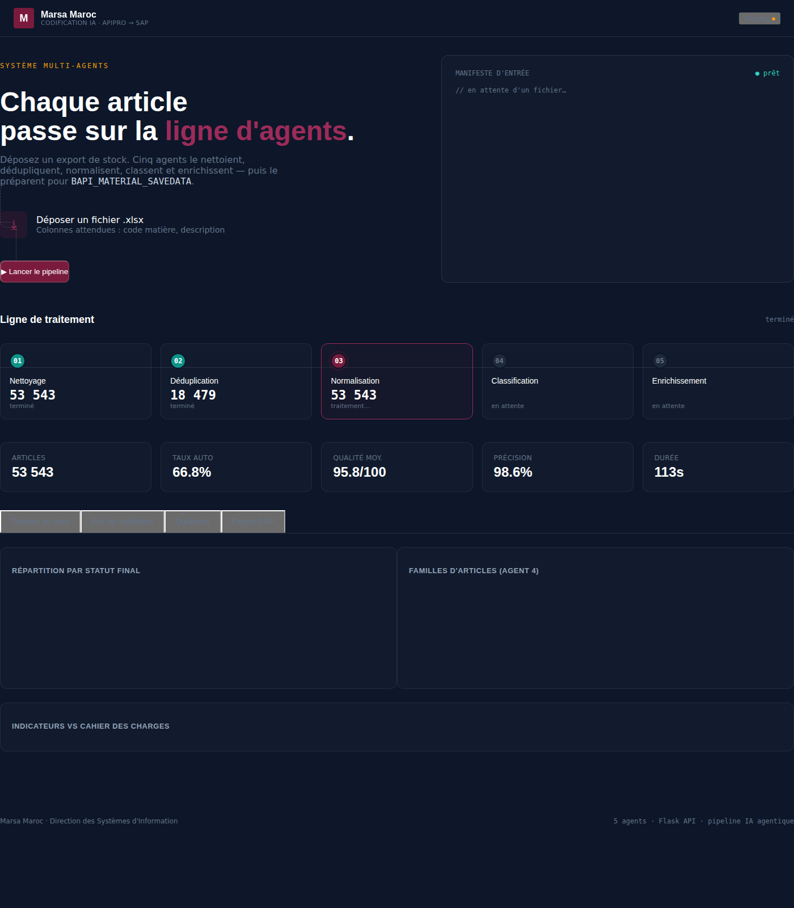
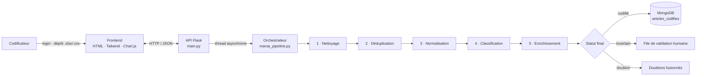

# Système multi-agents de codification des articles de stock — PFE Marsa Maroc

Projet de fin d'études d'ingénieur (Big Data & IA) réalisé chez **Marsa Maroc** (mars – juin 2026).

Application web qui **reprend, nettoie, déduplique et classe automatiquement un référentiel de 50 000+ articles de stock** réparti sur 7 ports. La chaîne de traitement repose sur des **agents spécialisés coordonnés par un orchestrateur**. Les cas incertains sont envoyés en **validation humaine** (*human-in-the-loop*) au lieu d'être tranchés au hasard.




---

## Problème

Le référentiel d'articles de l'ancien système (Apipro) est éclaté entre plusieurs sites et technologies (Oracle, SQL Server, Excel). On y trouve :

- des **doublons** d'un port à l'autre ;
- des **descriptions saisies en texte libre**, non normalisées ;
- des **champs manquants**, sans famille d'articles.

Le reprendre à la main prendrait des mois. Une automatisation totale serait risquée, car certaines décisions sont ambiguës.

**Objectif :** traiter automatiquement la masse des cas simples et réserver l'expert humain aux cas réellement incertains.

## Architecture



| Agent | Rôle | Technique |
|---|---|---|
| **1. Nettoyage** | Casse, distinction articles / prestations, score qualité, détection des lignes corrompues | Règles, expressions régulières |
| **2. Déduplication** | Détection des doublons inter-sites, robuste aux fautes de frappe et abréviations | **TF-IDF** (n-grammes de caractères) + **plus proches voisins** (cosinus) ; fusion auto ≥ 90 %, validation entre 85 et 90 % |
| **3. Normalisation** | Libellés conformes à la convention cible (≤ 40 caractères), abréviations | Dictionnaire d'abréviations |
| **4. Classification** | Attribution d'une famille parmi 22, avec indice de confiance | *Weak supervision* : étiquetage par règles, puis classifieur (régression logistique) |
| **5. Enrichissement** | Extraction de la marque, de la référence et des dimensions depuis le texte libre | Expressions régulières, liste de marques |

Chaque agent produit un **statut** et un **indice de confiance**. L'orchestrateur combine ces verdicts : un article corrompu est bloqué, un doute part en validation, un doublon non maître est fusionné, et le reste est codifié.

## Résultats

**Sur l'export réel de 53 543 références** (résultats présentés en soutenance, données non publiées) :

| Indicateur | Résultat | Cible |
|---|---|---|
| Traités automatiquement | **66,6 %** | ≥ 70 % |
| Précision de classification* | **98,5 %** | ≥ 90 % |
| Score qualité moyen | **95,8 / 100** | ≥ 90 |
| Doublons détectés | 18 481 paires → 45 032 articles uniques | — |
| Articles bloqués | 0 | minimal |

\* *Précision « weak » : mesurée sur les articles dont la famille est connue par règle, et non sur un jeu étiqueté à la main.*

Les 33,4 % restants partent en validation humaine, parce que l'export réel ne contient **ni famille, ni stock, ni prix** : seulement un code et une description.

**Sur le jeu synthétique fourni** (`data/articles_synthetiques.csv`, 5 300 lignes) : 85,4 % de traitement automatique, 776 articles en validation, score qualité 94,4/100.

## Structure

```
├── backend/
│   ├── main.py              # API Flask : auth, upload, pipeline asynchrone, résultats, export
│   ├── marsa_pipeline.py    # Les 5 agents + l'orchestrateur
│   └── marsa_mongo.py       # Persistance MongoDB (staging + articles codifiés)
├── frontend/
│   ├── index.html           # Login, dépôt, rail d'agents, tableau de bord, validation
│   ├── app.js
│   └── styles.css
├── data/
│   └── articles_synthetiques.csv   # Données fictives de démonstration
├── docs/apercu.png
└── requirements.txt
```

## Lancer le projet

```bash
git clone https://github.com/saadmekraz/PFE-Marsa-Maroc-Systeme-Multi-Agents.git
cd PFE-Marsa-Maroc-Systeme-Multi-Agents
pip install -r requirements.txt

# (optionnel) MongoDB local : mongod   — l'appli fonctionne aussi sans
python backend/main.py
```

1. Ouvrir **http://localhost:5000**.
2. Se connecter avec les identifiants de démo `admin` / `marsa2026`, modifiables via les variables `MARSA_USER`, `MARSA_PASS` et `MARSA_SECRET`.
3. Déposer `data/articles_synthetiques.csv`, puis cliquer sur **Lancer le pipeline**.

## API

| Méthode | Route | Rôle |
|---|---|---|
| POST | `/api/login` · `/api/logout` · GET `/api/me` | Authentification par session |
| POST | `/api/upload` | Charge un fichier, renvoie un `job_id` |
| POST | `/api/run/<job>` · GET `/api/status/<job>` | Pipeline asynchrone et suivi |
| GET | `/api/results/<job>/dashboard` · `/validation` · `/duplicates` · `/codifies` | Résultats |
| POST | `/api/save/<job>` | Écrit les articles codifiés dans MongoDB |
| GET | `/api/results/<job>/download/<kind>` | Export Excel |

## Perspectives

- Intégration vers SAP S/4HANA (BAPI) une fois l'accès disponible
- Agent 6 d'optimisation des stocks (ruptures, sur-stocks, valeur immobilisée), dès que la source fournit les données de stock
- Raisonnement des agents par LLM (approche ReAct)
- Tests automatisés et conteneurisation Docker

## Confidentialité

Ce dépôt ne contient **aucune donnée réelle de Marsa Maroc**. Le fichier `data/` est un jeu synthétique construit pour la démonstration.

## Auteur

**Saad Mekraz** — Ingénieur Data & IA · [LinkedIn](https://linkedin.com/in/saad-mekraz) · [GitHub](https://github.com/saadmekraz)
